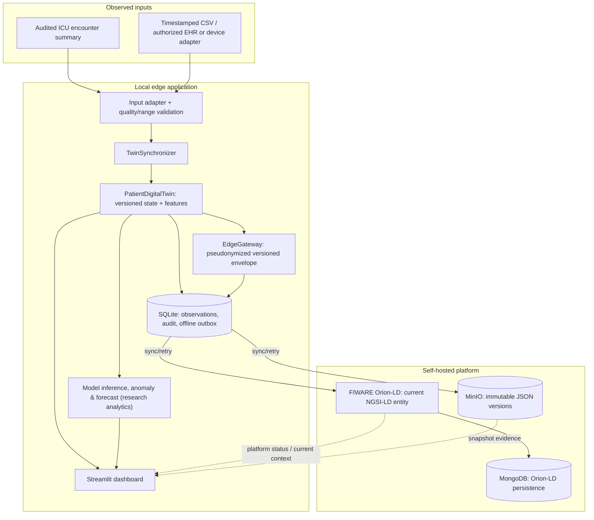
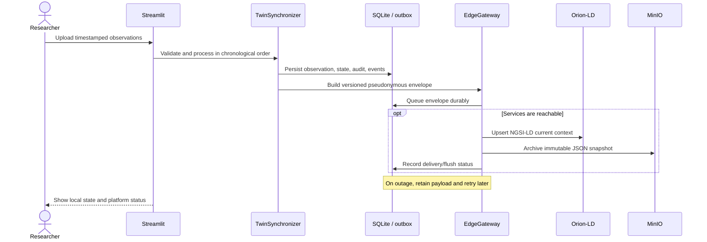

# CRITICALCARE-TWIN — System Architecture

CRITICALCARE-TWIN is an **offline-capable research prototype** that maintains a versioned patient digital-twin state from **observed** ICU encounter summaries and subsequently uploaded timestamped observations. Its local edge state is distinct from the two external stores: **FIWARE Orion-LD** for current NGSI-LD context and **MinIO** for immutable historical envelopes.

> **Research only.** Not a validated clinical device or decision-support system. The source dataset contains cross-sectional encounter summaries, not a live bedside monitoring stream.

## Component architecture

The arrows to Orion-LD and MinIO indicate **separate delivery attempts** using the same versioned envelope. A failure at either external destination does not block local twin updates.

## Observation and recovery sequence

## Ownership of data

| Component | Role | Important boundary |
| --- | --- | --- |
| `src/data/` | Observed-data adapters, preprocessing and validation | Reject malformed or implausible observations |
| `src/twin/` | State synchronization, derived features, versions, events | Local state is not proof of live bedside monitoring |
| `src/analytics/` | Trained risk model, forecasting and anomaly prototypes | Associations and research estimates, not clinical predictions |
| `src/edge/` | Pseudonymous envelopes, outage tolerance and resynchronization | Pseudonymization is **not** anonymization |
| SQLite | Local audit history, event persistence and durable outbox | Continues to work without Orion-LD or MinIO |
| FIWARE Orion-LD + MongoDB | Latest connected NGSI-LD context | Not an immutable audit archive |
| MinIO | Versioned JSON envelopes through an S3-compatible API | Not the authority for current twin state |
| Streamlit | Ingestion, investigation, evidence and platform visibility | Not an authenticated clinical dashboard |

## Reproducibility and evidence

- [README](README.md) — installation, run commands, observed CSV contract, held-out benchmark table.
- [Data provenance](reports/DATA_PROVENANCE.md), [dataset audit](reports/DATASET_AUDIT.md), and [data dictionary](DATA_DICTIONARY.md) — scope and source records.
- [Model evaluation](reports/MODEL_EVALUATION.md) — four-model 80/20 encounter-level comparison.
- [Test results](reports/TEST_RESULTS.md) and [project status](PROJECT_STATUS.md) — automated checks and outstanding workstation-dependent Docker verification.
- [Limitations](LIMITATIONS.md) and [model card](MODEL_CARD.md) — non-clinical boundaries.

## Deployment and validation status

The repository includes a Compose definition in `infra/compose.yaml` and a host verification script in `scripts/verify_platform.py`. The Python automated checks and local model evaluation are documented; **end-to-end verification against running platform containers has not been established on the original development workstation**. Before shared deployment, add TLS, identity/authorization, secret rotation, backups, monitoring, data governance and clinical validation.
