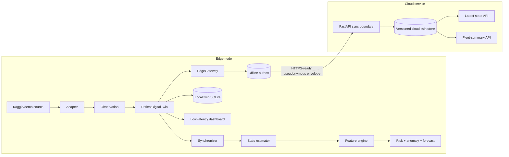

# Cloud-Edge Architecture

The architecture now separates the low-latency edge twin from the longitudinal cloud service. `PatientDigitalTwin` remains the aggregate root at the edge. `TwinSynchronizer` advances it through validation, confidence-weighted estimation, derived features, analytics, uncertainty, forecasting, events, and local persistence before `EdgeGateway` sends a reduced pseudonymous snapshot to the cloud boundary.

State and events use Pydantic contracts. The edge persists JSON snapshots locally before network transmission. The outbox survives cloud outages and retries immutable messages in order. The source patient ID is transformed into a salted SHA-256 pseudonymous key before a cloud payload is built; raw identifiers and raw observations are not sent. Scenario clones have no edge gateway and therefore cannot pollute the cloud record.

The cloud service exposes `GET /health`, `POST /v1/twins/sync`, `GET /v1/twins/{patient_key}/latest`, and `GET /v1/fleet/summary`. In the free demonstration it runs as a separate local process, accurately exercising the cloud boundary without claiming a commercial cloud deployment. Production deployment requires TLS, authenticated edge identities, managed secrets, access control, encryption, monitoring, and governance.
