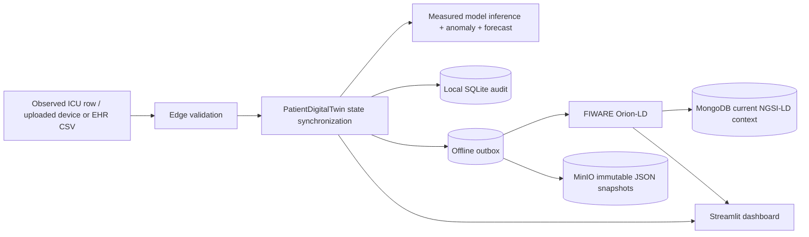

# CRITICALCARE-TWIN

Patient-specific digital-twin research software backed by a real, open-source digital-twin platform and S3-compatible object storage.

> Research software only. The model has no clinical validation and must not be used for diagnosis, treatment, triage, or patient management.

## Working architecture



For **detailed component and recovery diagrams**, see [ARCHITECTURE.md](ARCHITECTURE.md).

The production path does not generate synthetic telemetry. Initial state comes from observed encounter summaries in the audited ICU dataset. Further state transitions require timestamped observations uploaded through the dashboard or sent by a device/EHR adapter. The source dataset is cross-sectional, so the application does not claim that its encounter summaries are a live bedside stream.

### Free platform components

| Layer | Technology | Purpose |
|---|---|---|
| Digital-twin framework | FIWARE Orion-LD 1.12.0 | Stores and updates each patient twin as an NGSI-LD entity |
| Framework database | MongoDB 4.4 | Persists the current Orion-LD context |
| Object storage | MinIO | Stores immutable, versioned JSON snapshots through the S3 API |
| Edge persistence | SQLite | Stores observations, snapshots, events, predictions, and the offline outbox |
| Dashboard | Streamlit | Observed-data ingestion, state, evidence, and platform status |
| Analytics | scikit-learn | Held-out hospital-death model and transparent analytics |

FIWARE Orion-LD and MinIO are self-hosted open-source software. No AWS account or paid cloud service is required.

## Clone and install

```powershell
git clone https://github.com/Dheeraj1301/Dheeraj1301-criticalcare-twin.git
cd Dheeraj1301-criticalcare-twin
python -m venv .venv
Set-ExecutionPolicy -Scope Process -ExecutionPolicy Bypass
.venv\Scripts\Activate.ps1
python -m pip install --upgrade pip
python -m pip install -r requirements.txt
```

macOS/Linux activation:

```bash
python3 -m venv .venv
source .venv/bin/activate
python -m pip install --upgrade pip
python -m pip install -r requirements.txt
```

## Prepare observed data and model

```powershell
python scripts/download_data.py
python scripts/inspect_data.py
python scripts/prepare_data.py
python scripts/train_models.py
python -m pytest -q
```

The downloaded raw datasets are intentionally excluded from Git. The processed audited table and trained model are versioned for reproducibility.

## Start the free digital-twin platform

A running Docker-compatible daemon is required. On Windows, where the Compose plugin may be absent, use:

```powershell
powershell -ExecutionPolicy Bypass -File infra\start-free-stack.ps1
```

If Docker Compose is available:

```powershell
docker compose -f infra\compose.yaml up -d
```

Endpoints:

| Service | URL |
|---|---|
| Orion-LD version/health | http://127.0.0.1:1026/version |
| MinIO S3 API | http://127.0.0.1:9000 |
| MinIO console | http://127.0.0.1:9001 |

Local development credentials are `criticalcare` / `criticalcare-local`. Change them before any shared deployment.

Verify the real framework and storage path:

```powershell
python scripts/verify_platform.py
```

Stop containers while retaining data volumes:

```powershell
powershell -ExecutionPolicy Bypass -File infra\stop-free-stack.ps1
```

## Run the dashboard

```powershell
python -m streamlit run app.py
```

Open http://localhost:8501. The six workspaces are Command Center, Observation Ingestion, State Explorer, Risk & Explainability, Digital Twin Platform, and Evidence Lab.

### Observed CSV contract

Upload timestamped measurements on the Observation Ingestion page. The accepted columns are:

```text
timestamp,heart_rate,systolic_bp,diastolic_bp,respiratory_rate,spo2,temperature,glucose,potassium,gcs
```

Rows are range-validated, synchronized in timestamp order, persisted locally, transformed into a pseudonymous NGSI-LD entity, and archived to MinIO. A disconnected broker or object store does not block the local twin; the exact payload remains in the durable outbox until it is flushed.

## Measured prediction results

The training script compares four models on the same 80/20 stratified held-out split (seed 42). It selects by ROC-AUC; metrics are never manually raised.

| Model | ROC-AUC | PR-AUC | Precision @ 0.25 | Recall @ 0.25 | F1 @ 0.25 | Brier |
|---|---:|---:|---:|---:|---:|---:|
| Logistic regression | 0.840 | 0.399 | 0.142 | 0.938 | 0.246 | 0.163 |
| Random forest | 0.849 | 0.420 | 0.154 | 0.928 | 0.265 | 0.132 |
| Extra Trees | 0.846 | 0.421 | 0.136 | 0.960 | 0.238 | 0.150 |
| **Histogram gradient boosting (selected)** | **0.858** | **0.447** | **0.161** | **0.924** | **0.274** | **0.147** |

The selected model improves held-out ROC-AUC from 84.9% to 85.8% and PR-AUC from 42.0% to 44.7% versus the previous random forest. These are internal dataset results, not clinical accuracy or external validation.

## Verification status

| Check | Result |
|---|---|
| Python unit, persistence, gateway, privacy, and dashboard tests | 10 passed |
| Selected model held-out ROC-AUC | 0.8577 |
| Selected model held-out PR-AUC | 0.4467 |
| Real Orion-LD + MinIO end-to-end run on this workstation | Requires a running container daemon |

See [reports/TEST_RESULTS.md](reports/TEST_RESULTS.md) for the exact verification boundary.

## Repository structure

```text
app.py                 Streamlit application
config/                feature and runtime configuration
data/processed/        audited model table
data/metadata/         provenance and observed encounter profiles
infra/                 Orion-LD, MongoDB, and MinIO launch definitions
models/                selected fitted model and metrics
reports/               dataset, model, and test evidence
scripts/               preparation, training, and verification commands
src/cloud/             Orion-LD and S3-compatible storage adapters
src/data/              observed-data adapters, preprocessing, validation
src/edge/              pseudonymization, outbox, platform synchronization
src/twin/              state, synchronization, features, events, persistence
tests/                 automated verification
```

## Important limits

- The bundled ICU source contains encounter-level summaries, not longitudinal bedside telemetry.
- A complete live deployment still requires an authorized device/EHR feed, identity/access controls, TLS, secrets management, data governance, and clinical validation.
- Patient identifiers are pseudonymized before platform synchronization; pseudonymization is not anonymization.
- Model importance and displayed contributions are associations, not causal explanations.
