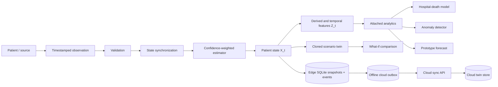

# CRITICALCARE-TWIN

**Patient-Specific Digital Twin for Critical-Care Monitoring, Deterioration Forecasting, and What-If Simulation**

> **Research and educational prototype. Not for clinical diagnosis, treatment, or patient management.** This software is not a medical device, has no clinical validation, and must not be used to prescribe treatment or manage a patient.

CRITICALCARE-TWIN is a cloud-edge research prototype that makes the digital-twin lifecycle inspectable. The edge node owns low-latency patient synchronization and remains operational offline. A deployable cloud API receives pseudonymous versioned summaries for longitudinal storage and fleet-level queries. The free demo runs both boundaries locally and does not pretend that a commercial cloud account is configured.

## Why a patient digital twin?

A patient digital twin is a computational representation that stays synchronized with observations of a physical patient. Here, an observed ICU encounter initializes the patient-specific baseline. Because the downloaded dataset is cross-sectional rather than bedside telemetry, a seeded generator produces clearly labelled **SIMULATED DEMO TELEMETRY**. The twin turns each observation into an auditable state transition.



## What makes this a twin

- `PatientDigitalTwin` owns identity, static properties, patient baseline, current and previous state, observation buffer, history, derived state, risk, uncertainty, alerts, forecasts, scenario results, provenance, synchronization time, and version.
- `TwinSynchronizer` executes validation → estimation → features → risk → anomaly → forecast → event → snapshot → persistence.
- Each parameter retains raw observation, filtered estimate, delta, rolling mean/SD, slope, trend, confidence, timestamp, and provenance class.
- Edge SQLite snapshots make state durable beyond one function call; a second durable outbox provides offline-safe cloud synchronization.
- Cloud envelopes use pseudonymous patient keys, idempotent message IDs, and explicit twin versions.
- Simulation clones the current twin; the critical isolation test proves a scenario cannot mutate the actual twin.

## Data and scientific boundary

All requested datasets are downloaded and audited in [reports/DATASET_AUDIT.md](reports/DATASET_AUDIT.md).

| Dataset | Rows | Role |
|---|---:|---|
| `mitishaagarwal/patient` | 91,713 | ICU encounter profiles and documented `hospital_death` target |
| `uom190346a/disease-symptoms-and-patient-profile-dataset` | 349 | Separate symptom/profile source; audit only |
| `abbas829/healthcare-patient-analytics-dataset` | 5,000 | Separate administrative source; provenance demonstration |

The datasets are **not joined**. Only the ICU table has an identifier usable within its own source. Similar demographics are not a scientifically defensible linkage key. Its vital signs are first-hour/day extrema, not a timestamped sequence; temporal replay is therefore simulated, fixed-seed, and never used to fabricate model labels.

## State and analytics

The dynamic state contains heart rate, systolic and diastolic blood pressure, respiratory rate, SpO₂, temperature, glucose, potassium, and a GCS proxy. The engine also computes MAP, pulse pressure, an HR/SBP proxy, rolling slopes and volatility, patient-baseline deviations, normalized deviations, missingness, and a **prototype instability metric**. None is presented as a validated bedside score.

The supervised model estimates the dataset's actual `hospital_death` outcome. Logistic regression and random forest are compared on a fixed stratified split; APACHE mortality probabilities, identifiers, and outcome-adjacent fields are excluded. An independent transparent anomaly detector combines patient-normalized deviations. Forecasts use local trends with widening uncertainty bands. Feature contributions are associations, not causal explanations.

The what-if laboratory clones the synchronized twin, applies controlled physiological perturbations, and compares baseline-clone and scenario-clone trajectories. It gives no dosage, intervention, or treatment advice.

## Dashboard

The seven workspaces are Command Center, Live Twin, State Explorer, Risk & Explainability, What-If Lab, Cloud & Edge, and Evidence Lab. Redundant architecture/data/model pages were consolidated. Every clinical field is classified as `OBSERVED`, `DERIVED`, `MODEL_ESTIMATED`, or `SIMULATED`.

## Installation and reproducible run

Python 3.11+ is recommended.

```powershell
python -m venv .venv
.venv\Scripts\Activate.ps1
python -m pip install -r requirements.txt
python scripts/download_data.py
python scripts/inspect_data.py
python scripts/prepare_data.py
python scripts/train_models.py
python -m pytest -q
```

Start the cloud boundary in terminal 1:

```powershell
python scripts/run_cloud.py
```

Start the edge dashboard in terminal 2:

```powershell
python -m streamlit run app.py
```

`python scripts/run_demo.py --launch` combines the lifecycle smoke test and dashboard launch. Dashboard startup does not retrain models.

For copy-paste VS Code commands and a plain-language explanation of every feature, see [RUN_AND_FEATURE_GUIDE.md](RUN_AND_FEATURE_GUIDE.md).

## Demo workflow

Select Patient B, open **Live Twin**, choose **Respiratory deterioration**, and play the stream. Watch source badges change to `SIMULATED`, state version increment, and events appear. In **State Explorer**, show observation → filtered state → trend. In **What-If Lab**, reduce SpO₂ by five points and demonstrate “actual twin isolation: VERIFIED.” See [DEMO_GUIDE.md](DEMO_GUIDE.md).

## Repository map

```text
config/          clinical feature, scenario, and runtime settings
data/            immutable raw, processed, synthetic, and metadata areas
models/          fitted model bundle and metadata
reports/         dataset audit, provenance, and model evaluation
scripts/         download, audit, preparation, training, and demo entry points
src/data/        adapters, preprocessing, validation
src/twin/        state, synchronizer, estimator, features, events, repository
src/analytics/   risk model, anomaly, forecast, explainability
src/simulation/  synthetic telemetry and cloned scenario engine
src/edge/        pseudonymization, cloud client, offline outbox
src/cloud/       deployable FastAPI synchronization and query service
src/ui/          components, charts, styling
tests/           lifecycle, feature, persistence, event, and isolation tests
```

## Documentation

- [DIGITAL_TWIN_SPEC.md](DIGITAL_TWIN_SPEC.md) — formal entities and equations
- [PIPELINE.md](PIPELINE.md) — operational stage contracts
- [ARCHITECTURE.md](ARCHITECTURE.md) — component responsibilities
- [MODEL_CARD.md](MODEL_CARD.md) — intended use and limitations
- [DATA_DICTIONARY.md](DATA_DICTIONARY.md) — field semantics and provenance classes
- [LIMITATIONS.md](LIMITATIONS.md) — scientific and engineering limits
- [PROJECT_STATUS.md](PROJECT_STATUS.md) — verified readiness state
- `output/pdf/CRITICALCARE_TWIN_Cloud_Edge_Architecture.pdf` — illustrated architecture and dataset evidence report

## Ethical limitations and future work

The source is not a live EHR; replay is not a physiological simulator; random-split metrics do not show temporal or external validity; subgroup fairness has not been established; and missing measurements may be informative. Future work requires governed longitudinal data, clinical-domain review, external validation, calibrated uncertainty, fairness analysis, and prospective human-factors testing before considering clinical evaluation.

## Optional GitHub publication after local review

```powershell
git add .
git commit -m "Build CRITICALCARE-TWIN research prototype"
git branch -M main
git remote add origin https://github.com/YOUR_USER/criticalcare-twin.git
git push -u origin main
```
